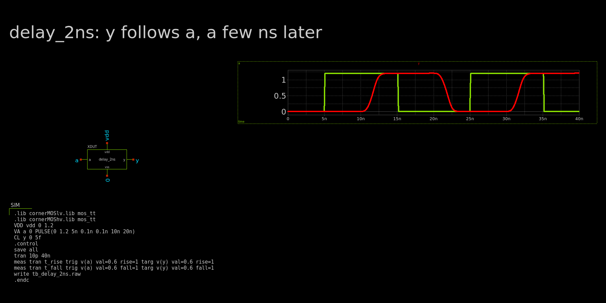
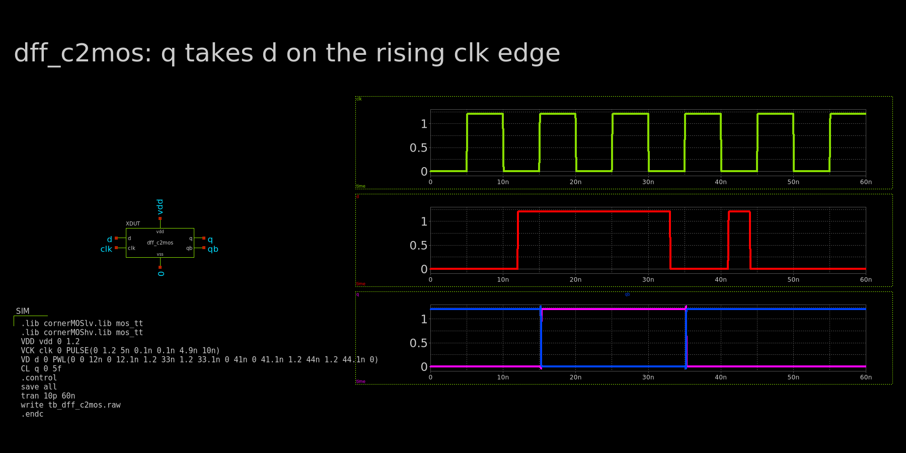
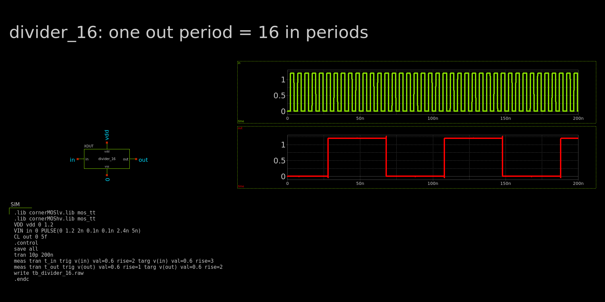
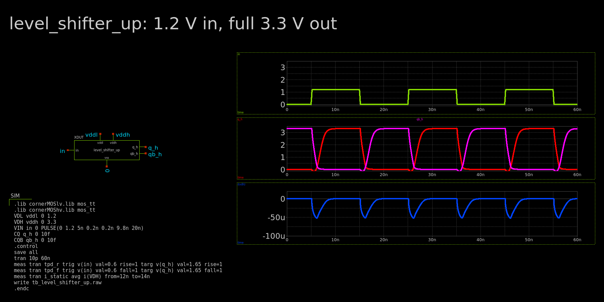
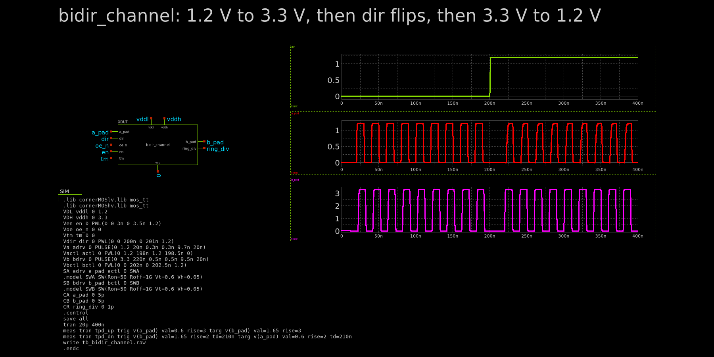
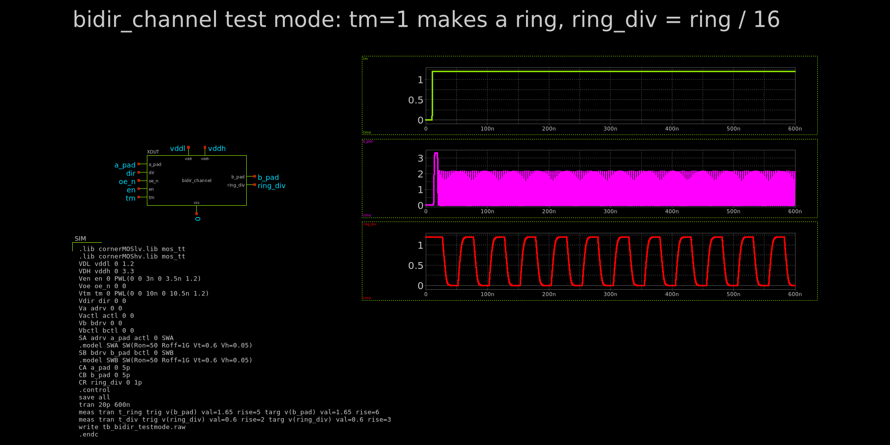
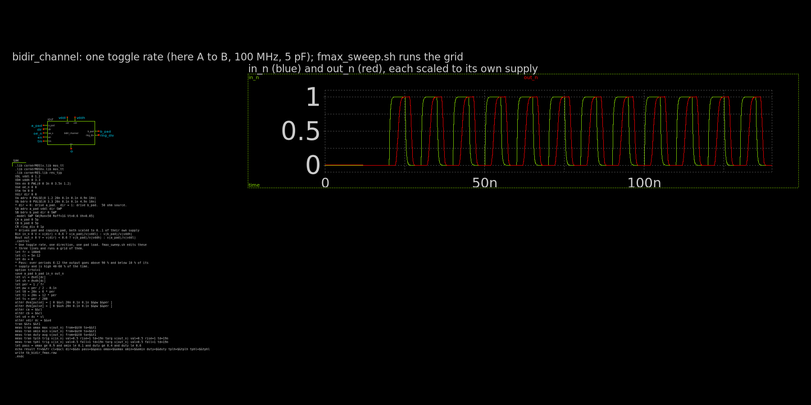
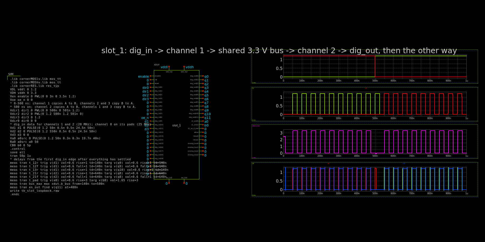

# Verification

Each block has its own testbench here. All of them use the real IHP models
(`mos_tt`, 27 °C). The screenshots come straight from xschem, and the graphs
load the sim results by themselves.

## delay_2ns

*`a` (green) goes in, `y` (red) comes out. `y` follows `a` about 6.6 ns later
on both edges.*

This checks the delay that the channel uses for break-before-make. `y` never
flips before `a`, so a driver can't turn on early. Note: with the real models
it is ~6.6 ns, not 2 ns.

## dff_c2mos

*`clk` on top, `d` in the middle, `q` (pink) and `qb` (blue) on the bottom.*

`q` only changes on a rising `clk` edge (15 ns and 35 ns). The short `d` pulse
at 41–44 ns sits between two edges, so `q` ignores it. `qb` is always the
opposite of `q`. So it is an edge-triggered flip-flop, not a latch.

## divider_16

*200 MHz `in` on top, `out` on the bottom.*

One `out` period is 80 ns, which is 16 `in` periods (16 × 5 ns). So the four
flip-flops divide by 16.

## level_shifter_up

*`in` (0–1.2 V) on top, `q_h` (red) and `qb_h` (pink) in the middle, 3.3 V
supply current on the bottom.*

A 1.2 V input gives a full 0–3.3 V output on both sides. Delay is 1.9 ns
(rise) and 0.5 ns (fall). Current only flows during a switch. In between it is
about 12 nA, so the latch doesn't burn DC current.

## bidir_channel: both directions

*`dir` on top, `a_pad` (1.2 V side) in the middle, `b_pad` (3.3 V side) on
the bottom. 5 pF on each pad.*

For the first 200 ns `dir = 0`: we drive `a_pad` and `b_pad` copies it at
3.3 V (2.3 ns delay). Then `dir` flips, we drive `b_pad`, and `a_pad` copies
it at 1.2 V (2.6 ns delay). Both pads stay quiet around the flip, so the two
drivers never fight.

## bidir_channel: test mode

*`tm` on top, `b_pad` in the middle, `ring_div` on the bottom.*

With `tm = 1` the channel loops back on itself and rings. The ring period is
3.2 ns (~317 MHz). `ring_div` has a 50.5 ns period, which is 16 × 3.2 ns, so
the divider works inside the channel too. `b_pad` doesn't reach a full 3.3 V
here because 5 pF is a lot to swing at that speed, but the loop keeps going.

## bidir_channel: how fast

*One run of `tb_bidir_fmax`: A to B at 100 MHz with 5 pF on the pads.
`in_n` is the driven pad and `out_n` the copy, each scaled to its own
supply.*

`fmax_sweep.sh` runs that bench at 25-300 MHz in each direction, with 5 pF
(a pin with a probe) and 0.5 pF (another block on the chip) on the pads, at
five corners. A rate passes if, over 6 periods, the copy goes above 90 % and
below 10 % of its supply and is high 40-60 % of the time. The table gives the
highest rate where it and every slower rate pass. Data rate is twice that
(one bit per edge). Delays are at 25 MHz.

| corner | load | A→B fmax | B→A fmax | A→B tpLH / tpHL | B→A tpLH / tpHL |
|---|---|---:|---:|---:|---:|
| tt | 5 pF | 100 MHz | 50 MHz | 2.63 / 1.81 ns | 2.67 / 1.29 ns |
| tt | 0.5 pF | 175 MHz | 75 MHz | 1.83 / 1.28 ns | 1.67 / 0.67 ns |
| ss | 5 pF | 100 MHz | 50 MHz | 3.05 / 2.22 ns | 3.34 / 1.55 ns |
| ff | 5 pF | 100 MHz | 75 MHz | 2.33 / 1.53 ns | 2.16 / 1.09 ns |
| tt, supplies −10 % | 5 pF | 100 MHz | 25 MHz | 3.13 / 2.29 ns | 3.51 / 1.54 ns |
| ss, −10 %, 125 °C | 5 pF | 75 MHz | 25 MHz | 4.41 / 3.32 ns | 4.31 / 2.01 ns |
| ss, −10 %, 125 °C | 0.5 pF | 150 MHz | 50 MHz | 3.20 / 2.56 ns | 2.67 / 1.06 ns |

(Full table, all corners and loads: `sh verification/fmax_sweep.sh`.)

What limits it is not the swing: the copy still goes rail to rail at
200-300 MHz. It is the duty cycle. Rising edges are slower than falling ones
(by 0.8 ns A to B and 1.4 ns B to A at tt, 5 pF), so at high rates the
high time shrinks below 40 %. B to A is the slower direction. The test-mode
ring (317 MHz, 3.2 ns period) is faster than either, because a ring doesn't
care about the duty cycle.

### After layout

`VIEW=pex sh verification/fmax_sweep.sh` runs the same sweep on the
extracted layout (`layout/pex.sh`: magic, flattened, capacitance only, no
wire resistance).

| corner | load | A→B fmax | B→A fmax | A→B tpLH / tpHL | B→A tpLH / tpHL |
|---|---|---:|---:|---:|---:|
| tt | 5 pF | 50 MHz | 25 MHz | 4.30 / 2.89 ns | 5.70 / 2.16 ns |
| tt | 0.5 pF | 75 MHz | 25 MHz | 3.42 / 2.30 ns | 5.03 / 1.45 ns |
| ss, −10 %, 125 °C | 5 pF | 50 MHz | below 25 MHz | 8.42 / 6.13 ns | 9.29 / 3.41 ns |
| ss, −10 %, 125 °C | 0.5 pF | 50 MHz | below 25 MHz | 7.15 / 5.33 ns | 8.23 / 2.33 ns |

The wiring roughly halves the speed, and it makes the rising edge B to A
much slower than the falling one (5.7 vs 2.2 ns at tt). In the slow corner
B to A still swings rail to rail at 25 MHz, but it is high only 35 % of the
time, so it fails the duty-cycle test: below 25 MHz it would pass.

Where the B-to-A skew comes from (schematic, tt, 5 pF, delay from `b_pad`):

| node | rising | falling |
|---|---:|---:|
| `net18`, `net19` (3.3 V receiver, mux) | 0.21 / 0.22 ns | 0.12 / 0.15 ns |
| `net20` (`MP8`/`MN9`, thick oxide on 1.2 V) | 0.86 ns | 0.24 ns |
| `net21` (after the Schmitt trigger) | 1.22 ns | 0.35 ns |
| `a_pad` | 2.67 ns | 1.29 ns |

`MP8` (1 µm thick-oxide PMOS on 1.2 V) pulls `net20` up 3.6 times slower
than `MN9` pulls it down, which is about half the skew. Making `MP8` 3-4
times wider is the obvious next change; it hasn't been done or simulated
yet.

## slot_1: the digital loopback

*`dir1` and `dir2` on top, `d1`/`d2` (the `dig_in` data) next, the shared
3.3 V bus `b_bus`, and `dig_out[9]`/`[8]`/`[10]` on the bottom.*

The whole slot, with the interface logic. For the first 500 ns channel 1
copies A to B and channels 2 and 3 copy B to A: `dig_in[9]` goes through
channel 1 up to 3.3 V, onto `b_bus`, and back down through channels 2 and 3
to `dig_out[9]` and `dig_out[10]`. Then the two `dir` bits swap and
`dig_in[10]` comes back on `dig_out[8]` the other way. At 20 MHz the bus
swings the full 0-3.33 V. From `dig_in` to `dig_out`, up and down again:

| path | rising | falling |
|---|---:|---:|
| `dig_in[9]` → ch 1 → bus → ch 2 → `dig_out[9]` | 3.65 ns | 2.15 ns |
| `dig_in[9]` → ch 1 → bus → ch 3 → `dig_out[10]` | 3.65 ns | – |
| `dig_in[10]` → ch 2 → bus → ch 1 → `dig_out[8]` | 3.65 ns | 2.15 ns |
| ch 0 pads, `s1_an[0]` → `s1_an[1]` (5 pF) | 2.53 ns | – |

`dig_out[11]` follows `enable`. The harness's SPI and GPIO routing are much
slower than any of this, so the slot's own digital pins can't show the
limit: that is what the test-mode ring and its ÷16 and ÷256 outputs are for.

## Area

From the layouts (`layout/`), with the 1 µm supply rails, side buses and
guard ring:

| Cell | Size |
|---|---|
| `level_shifter_up` | 28.4 × 9.4 µm |
| `delay_2ns` | 43.1 × 11.7 µm |
| `divider_16` | 75.5 × 24.7 µm |
| `bidir_channel` | 102.8 × 101.6 µm |
| four channels and interface (`slot_1` core) | 434.5 × 142.9 µm |
| `slot_1` (the harness's slot 1) | 537.15 × 273 µm |

The old netlist estimate (`area.py`, ~2,200 µm² per channel) left out
routing; the routed channel is about 10,400 µm².
